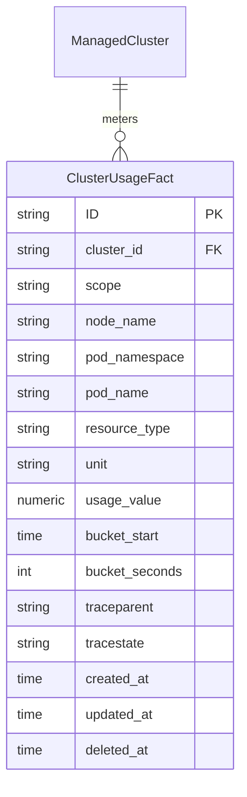

# Cluster Usage Metering Data Model

**Date:** 2026-11-20
**Status:** Active
**Ticket:** HYPERSHELL-532
**Related:** [`data-model.spec.md`](./data-model.spec.md), [`managed-cluster-registration.spec.md`](./managed-cluster-registration.spec.md), [`hub-cluster-utilization-trends.spec.md`](./hub-cluster-utilization-trends.spec.md)

## Purpose

Define the canonical data model for metering cluster-level usage across HyperShell-managed
clusters, so that cluster, node, pod, and resource consumption are represented
consistently, usage facts have a single source of truth, and the model supports
aggregation, retention, and future cost attribution.

## Overview

A **ClusterUsageFact** is one measured quantity of resource consumption, attributed to a
`ManagedCluster` and bounded to a fixed time bucket. A single dimensional entity represents
all three measurement levels (cluster, node, pod) through a `scope` discriminator, so a
node fact and a pod fact share one schema and one aggregation path rather than three
divergent tables.

Usage facts are persisted in the API server's PostgreSQL database, which is the single
source of truth. Point-in-time Prometheus utilization widgets (see
[`hub-cluster-utilization-trends.spec.md`](./hub-cluster-utilization-trends.spec.md)) are
ephemeral and hub-cluster scoped; they are not a metering record and do not satisfy this
model.

"Fleet-scale" aggregation means aggregating facts across all `ManagedCluster`s. Consistent
with the platform model, there is no Fleet or Sector entity and no `fleet_id`: resources
are top-level and tenancy is enforced by RBAC (see
[`data-model.spec.md`](./data-model.spec.md)). Aggregation is therefore a grouping over
`cluster_id` and time, never a join to a fleet grouping.

A ClusterUsageFact records only measured consumption. It carries no price or rate: cost
attribution is a future capability that joins these facts to a separate pricing model, and
is out of scope for this spec.

The ingestion path that produces node, pod, and resource consumption values is a
dependency, not part of this model. No component collects per-managed-cluster node or pod
consumption today; this spec defines the desired storage schema those producers will write
to.

## Entity Relationship Diagram

## Requirements

### Requirement: Uniquely Identifiable Usage Facts

Each ClusterUsageFact SHALL carry a KSUID primary key assigned on create, and SHALL be
unique on the natural tuple `(cluster_id, scope, node_name, pod_namespace, pod_name,
resource_type, bucket_start)` among non-deleted rows. Writes for an existing tuple SHALL
upsert the `usage_value` rather than insert a duplicate.

#### Scenario: Create a Cluster-Scope Usage Fact

- GIVEN a registered `ManagedCluster` with a valid cluster_id
- WHEN a usage fact is written with `scope` = `cluster`, a `resource_type`, and a
  `bucket_start`
- THEN a new ClusterUsageFact is created with a KSUID `id`
- AND it references a valid ManagedCluster via `cluster_id`

#### Scenario: Re-report the Same Bucket

- GIVEN an existing ClusterUsageFact for a `(cluster_id, scope, node_name, pod_namespace,
  pod_name, resource_type, bucket_start)` tuple
- WHEN a fact is written again for the identical tuple
- THEN the existing fact's `usage_value` is updated in place
- AND no duplicate row is created

### Requirement: Time-Bounded Hourly Buckets

Each ClusterUsageFact SHALL be bounded by a `bucket_start` truncated to the top of a UTC
hour and a `bucket_seconds` width. The default grain SHALL be hourly (`bucket_seconds` =
3600). A fact SHALL represent consumption within `[bucket_start, bucket_start +
bucket_seconds)`.

#### Scenario: Hourly Bucket Boundaries

- GIVEN consumption measured for a cluster between 09:00 and 10:00 UTC
- WHEN the usage fact is written
- THEN `bucket_start` is 09:00:00 UTC
- AND `bucket_seconds` is 3600

### Requirement: Consistent Cluster, Node, and Pod Representation

A ClusterUsageFact SHALL use a `scope` of `cluster`, `node`, or `pod` to indicate the
measurement level, and SHALL carry a `resource_type` (for example `cpu`, `memory`,
`storage`) with an explicit `unit`. `node_name` SHALL be set when `scope` is `node` or
`pod`; `pod_namespace` and `pod_name` SHALL be set when `scope` is `pod`.

#### Scenario: Pod-Scope Fact Carries Its Dimensions

- GIVEN a pod consuming CPU on a node in a managed cluster
- WHEN a usage fact is written with `scope` = `pod`
- THEN `node_name`, `pod_namespace`, and `pod_name` are all set
- AND `resource_type` is `cpu` with a defined `unit`

### Requirement: Fleet-Scale Aggregation

The model SHALL support aggregation across all `ManagedCluster`s by grouping on
`cluster_id`, `resource_type`, and `bucket_start`. Aggregation SHALL NOT depend on any
fleet or sector grouping, and the schema SHALL NOT include a `fleet_id`.

#### Scenario: Aggregate CPU Across the Fleet for One Hour

- GIVEN cluster-scope CPU facts for multiple managed clusters in the 09:00 UTC bucket
- WHEN usage is aggregated for that bucket and `resource_type` = `cpu`
- THEN the result sums `usage_value` grouped by `bucket_start` across all clusters
- AND the aggregation requires no fleet grouping

### Requirement: Configurable Retention

Usage facts SHALL be retained for a configurable window, defaulting to 90 days. A retention
operation SHALL delete facts whose `bucket_start` is older than the cutoff.

#### Scenario: Prune Facts Older Than the Retention Window

- GIVEN ClusterUsageFacts with `bucket_start` older than the configured retention window
- WHEN the retention operation runs
- THEN facts older than the cutoff are deleted
- AND facts within the window are retained

## Field Reference

| Field | Type | Description |
|-------|------|-------------|
| `id` | string | KSUID primary key, assigned on create |
| `cluster_id` | string | Foreign key to `ManagedCluster.id` |
| `scope` | string | Measurement level: `cluster`, `node`, or `pod` |
| `node_name` | string | Node name; set when `scope` is `node` or `pod` |
| `pod_namespace` | string | Pod namespace; set when `scope` is `pod` |
| `pod_name` | string | Pod name; set when `scope` is `pod` |
| `resource_type` | string | Measured resource, for example `cpu`, `memory`, `storage` |
| `unit` | string | Unit of `usage_value`, for example `core-seconds`, `byte-seconds` |
| `usage_value` | numeric | Consumed quantity within the bucket |
| `bucket_start` | time | UTC hour-truncated lower bound of the time bucket |
| `bucket_seconds` | int | Bucket width in seconds (3600 for hourly) |
| `created_at` | time | Row creation timestamp |
| `updated_at` | time | Row update timestamp |
| `deleted_at` | time | Soft-delete timestamp; unique index applies where null |

## Design Decisions

| Decision | Rationale |
|----------|-----------|
| Single dimensional fact table with a `scope` discriminator | One schema and one aggregation path for cluster, node, and pod facts; avoids three divergent tables and keeps cross-level aggregation unambiguous |
| KSUID primary key plus natural-tuple unique index | KSUID gives sortable, coordination-free identity; the unique index plus upsert makes re-reported buckets idempotent, matching the `UserDailyActivity` precedent |
| Hourly buckets, retention default 90 days | Hourly grain supports intra-day attribution and monthly billing cycles; 90 days outlives a billing period. Diverges from the daily/30-day `UserDailyActivity` precedent because cost attribution needs finer grain and longer history |
| No `fleet_id`; aggregate by `cluster_id` | Fleet/Sector grouping was removed platform-wide; tenancy is RBAC. Fleet-scale aggregation is a grouping over clusters, not a join to a grouping entity |
| No price or rate field | A fact records measured consumption only. Cost attribution joins to a separate pricing model later; embedding rates here would couple metering to pricing |
| Ingestion source out of scope | Node, pod, and resource consumption are not collected today. This spec defines the storage contract; producers are a separate dependency |
